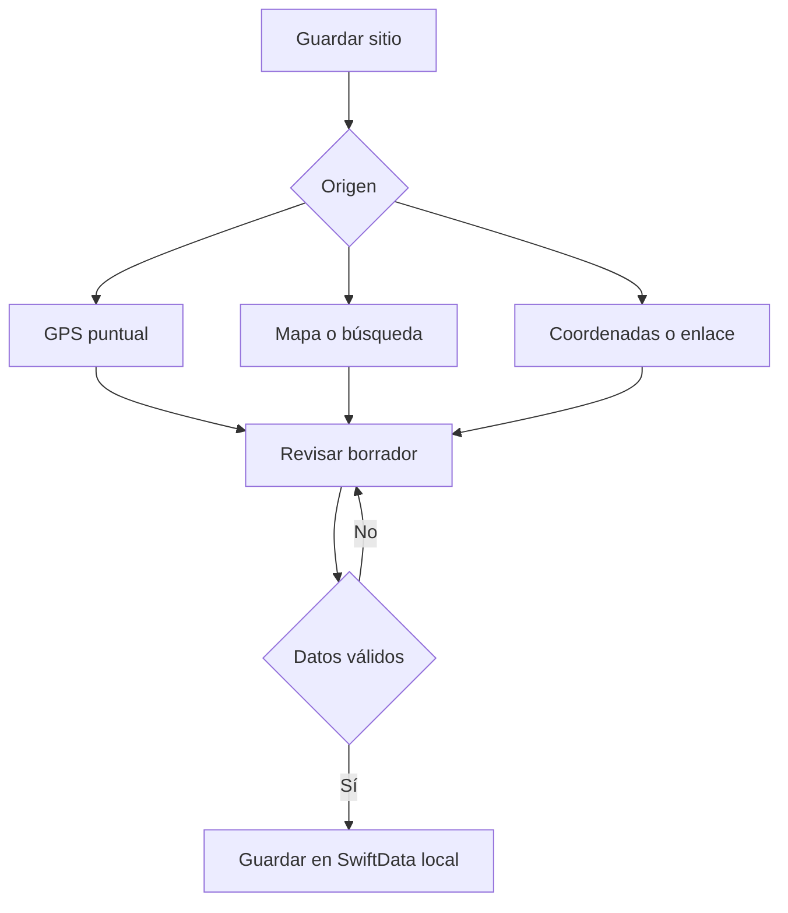

# Arquitectura y datos

## Elecciones

Swift + SwiftUI para una app nativa de iPhone. SwiftData para persistencia de modelos; MapKit para mapa y búsqueda; Core Location para GPS puntual. Sin dependencias externas. Se usa una estructura sencilla de vistas y servicios, sin añadir capas que un estudiante deba mantener sin necesidad.

## Componentes

| Archivo | Responsabilidad |
|---|---|
| `PinHavenApp.swift` | Abrir el contenedor local y presentar un error recuperable sin destruir la base |
| `Models/Place.swift` | Entidad persistente SwiftData |
| `Models/PlaceRecord.swift` | DTO portable, límites, búsqueda y formato versionado de respaldo |
| `Services/PlaceMapping.swift` | Convertir entre entidad persistida y DTO |
| `Services/LocalStore.swift` | Directorio local, exclusión de backup y transacción de importación |
| `Services/LocationService.swift` | Permiso y solicitud puntual GPS con timeout |
| `Services/MapLinks.swift` | Interpretar coordenadas explícitas y construir enlaces |
| `Views/HomeView.swift` | Consulta reactiva, filtros, lista y mapa |
| `Views/PlaceEditor.swift` | Borrador de creación/edición y validación antes de persistir |
| `Views/MapPicker.swift` | Seleccionar punto y buscar con MapKit |
| `Views/PlaceDetail.swift` | Consultar, compartir, navegar y borrar |
| `Views/BackupView.swift` | Importación/exportación con selección explícita de archivo |

## Flujo de captura

El editor conserva un `PlaceRecord` en memoria. Cancelar no muta la entidad existente. Solamente al guardar se aplica el borrador, se ejecuta `save()` y, ante fallo, `rollback()`.

## Modelo `Place`

| Campo | Tipo | Uso |
|---|---|---|
| id | UUID único | Identidad e importación repetible |
| name | String | Nombre personal obligatorio |
| address | String | Dirección opcional |
| latitude / longitude | Double | Punto exacto; valores decimales |
| notes | String | Contexto personal |
| category | String | Categoría principal |
| tags | String | Etiquetas, separadas por comas |
| isFavorite | Bool | Favorito |
| sourceURL | String | Referencia original; no se abre automáticamente |
| createdAt / updatedAt | Date | Auditoría local y orden |

## Persistencia

`Application Support/PinHaven/places.store`; carpeta marcada `isExcludedFromBackup` antes de abrir el almacén y con protección de archivos completa al crearse. CloudKit desactivado explícitamente. SQLite y archivos auxiliares son administrados por SwiftData; no editar manualmente ni empaquetar bases reales dentro del repositorio.

Si el almacén no abre, se muestra una pantalla de recuperación; no se sustituye silenciosamente por una base vacía ni por una base solo en memoria. Queda pendiente validar protección y exclusión en dispositivo real.

## Respaldo

Objeto JSON con `schemaVersion: 1`, `exportedAt` y `places`. UUID como cadena y fechas ISO 8601. El formato contiene todos los campos actuales de `PlaceRecord`; no hay imágenes en esta versión.

La importación limita archivo a 20 MiB y 10.000 registros, valida todos antes de insertar y rechaza UUID repetidos dentro del archivo. Agrega únicamente UUID no presentes y hace un guardado único. El error produce rollback. Los archivos exportados por esta versión tienen el formato que consume el importador.

Para cambiar el formato, incrementar `schemaVersion` y escribir migración explícita; no relajar silenciosamente validaciones. Para cambiar entidades persistentes en una versión distribuida, introducir `VersionedSchema` y `SchemaMigrationPlan` y probar contra una copia de datos anterior.

## Importación de enlaces

Solo HTTP/HTTPS de hosts concretos, más el formato directo `latitud,longitud`. Google: `query`, `q` o `destination` con par numérico. Apple: los anteriores y `ll` o `coordinate`. No interpretar `@lat,lon` de Google porque suele representar la cámara del mapa. No hay solicitudes de red para interpretar enlaces.

## Límites de escalabilidad

La versión inicial consulta todos los sitios y filtra en memoria; adecuada como punto de partida de una agenda personal, sin afirmación de rendimiento medida. Antes de grandes volúmenes, medir en iPhone y evaluar predicados SwiftData, índices, paginación y agrupación de marcadores. No almacenar fotos grandes como campos de texto o Base64 en este modelo.

## Sugerencias de dirección y navegación (2026-11-04)

AddressSearch mantiene sugerencias MapKit y resuelve únicamente la elección explícita. Un token invalida respuestas antiguas y la operación se cancela al salir o cambiar la consulta. CNPostalAddressFormatter conserva los componentes postales disponibles sin requerir acceso a la agenda. No cambia el esquema SwiftData. MapsWebView presenta la alternativa web con SFSafariViewController.

Compartir usa un URL universal por coordenadas. Google Maps instalado puede abrirse por comgooglemaps (declarado en LSApplicationQueriesSchemes); si no está disponible se usa el enlace universal. El punto guardado es el destino, independientemente del texto descriptivo.

## Referencia de búsqueda separada del sitio

PlaceEditor mantiene una instancia LocationService independiente para searchReference, sin mezclar sus callbacks con el GPS que fija el punto del sitio. Cambiar referencia o alcance vuelve a consultar AddressSearch; se conserva la misma región para resolver la sugerencia. regionPriority.required se protege por versión de compilador y disponibilidad iOS 18 para conservar compatibilidad Xcode 15/iOS 17. El menú de compartir reutiliza la apertura de Google existente.

## Compartir con extensiones de mensajería

LocationShareSheet encapsula UIActivityViewController con un solo String (nombre, dirección y enlace) capturado en LocationSharePayload. Sustituye ShareLink de URL para el botón Compartir con otras apps. El callback solo informa error local a la vista, que lo muestra tras cerrar la hoja; no representa confirmación de envío ni entrega remota.

## Recepción por Share Extension — 2026-11-05

PinHavenShare ejecuta ShareViewController y aloja ShareCaptureView en SwiftUI. NSItemProvider lee URL/texto; IncomingMapLink valida el origen, interpreta únicamente coordenadas explícitas y expande enlaces mediante HEAD acotado. MapPicker se comparte entre targets para corregir/buscar el punto cuando sea necesario.

Shared contiene el parser/resolver y SharedInbox, compilados en ambos procesos. SharedCapture versiona un PlaceRecord confirmado. La extensión escribe un JSON por UUID en PendingPlaces del App Group; no abre SwiftData. HomeView consume al entrar/activar app: validar, guardar por LocalStore.importBackup y después retirar el JSON. La base actual y el esquema se conservan; no se necesita migrarla porque no se mueve al grupo.

El target extensión se embebe en PlugIns y es dependencia de la app; usa únicamente APIs compatibles con extensiones. Ambos targets declaran group.com.innovalogic.pinhaven y comparten variables de versión. Los perfiles/grupo se deben registrar en Apple, además de configurar Git.

## Dirección de un punto

Shared/PointAddressLookup usa ReverseAddressProvider (CLGeocoder en producción) y publica candidatos de texto, nunca modifica registros ni coordenadas. PointAddressSuggestionView aplica solo una dirección elegida al borrador y cancela resultados al cambiar el pin o salir. AddressSearch admite tamaño regional configurable: 4 km de lado para el punto del sitio; conserva 40 km por defecto para el GPS opcional. Autocompletado sigue resolviendo y aplicando dirección/punto juntos.

## Revisión de bandeja y duplicados

InboxView lee hasta 200 pendientes inicialmente y permite mostrar más; expone entradas válidas e ilegibles sin destruirlas. HomeView muestra acceso permanente a la bandeja y un aviso con cantidad pendiente. Al cerrar la bandeja se refresca el consumo; no se consume automáticamente mientras se revisa o se crea un sitio desde HomeView.

PlaceDuplicates compara DTO válidos con CoreLocation.distance, sin usar ubicación del teléfono ni red. Excluye el propio UUID al editar. DuplicateReviewView muestra coincidencias aproximadas, permite abrir la ficha y presenta los campos de ubicación propuestos antes de confirmar una actualización. No se modifica Place hasta confirmar.

SharedInboxImport incorpora automáticamente solo capturas nuevas sin coincidencias; los duplicados quedan en disco. La aceptación explícita usa el UUID de la captura original por separado del UUID del sitio actualizado. Secuencia: escribir intención incompleta en InboxReceipt atómico/protegido en PendingPlaces/Processed, guardar SwiftData, marcar recibo completado, retirar pendiente. El recibo guarda versión, dos UUID y estado de finalización; impide repetir actualizaciones o resucitar borrados. No migra Place ni mueve la base.

No hay una transacción única entre SwiftData y archivos. Si falla escribir la intención, no se modifica SwiftData. Una intención incompleta siempre queda para revisión explícita, incluso si el punto corregido está lejos del original y su enlace cambió. Si el sitio vinculado sigue existiendo, la revisión abre sus datos guardados para comprobarlos/corregirlos; no reaplica el original automáticamente. Un error al retirar conserva recibo completado y pendiente para terminar en el siguiente intento. Sin recibo, un UUID ya guardado se omite sin sobrescribir. La restauración JSON sigue omitiendo UUID presentes, sin deduplicación geográfica.

## Compartir enlace y tarjeta visual

LocationShareContent crea un DTO limitado a nombre, dirección, punto y URL; no lleva notas ni otros datos privados del modelo. LocationShareLink verifica fichas Google con pin explícito antes de reutilizarlas; limpia query/fragmento y usa coordenadas guardadas ante ambigüedad o error. Solo expande enlaces cortos por el resolver HTTPS/HEAD existente; no descarga páginas HTML ni hace búsquedas aproximadas. PlaceDetail captura el DTO del sitio al pulsar y descarta preparaciones canceladas o anteriores a una edición.

LocationMapCard usa un LocationMapSnapshotProvider inyectable; producción llama MKMapSnapshotter con región de 900 m y tamaño 1080×640. El compositor dibuja el snapshot completo y añade un pin mediante point(for:), sin tapar la atribución del borde; valida límites y rechaza puntos fuera del mapa. Renderiza marca, nombre/dirección acotados visualmente, coordenadas y atribución exterior sobre fondo claro. El enlace del mensaje usa el punto guardado. La salida UIImage vive en memoria, sin cache persistente propia.

MapShareCardView permite revisar, reintentar y elegir imagen/texto o solo enlace. LocationShareSheet recibe LocationSharePayload: enlace = un String; tarjeta = UIImage y String. El callback solo recoge errores locales; no prueba entrega a WhatsApp. LocationMapCard invalida respuestas antiguas/canceladas y cancela el snapshot a los 15 s. Cerrar detiene trabajo; abrir la hoja nativa conserva la imagen preparada al volver. La vista previa de iOS no controla el aspecto final del chat.
