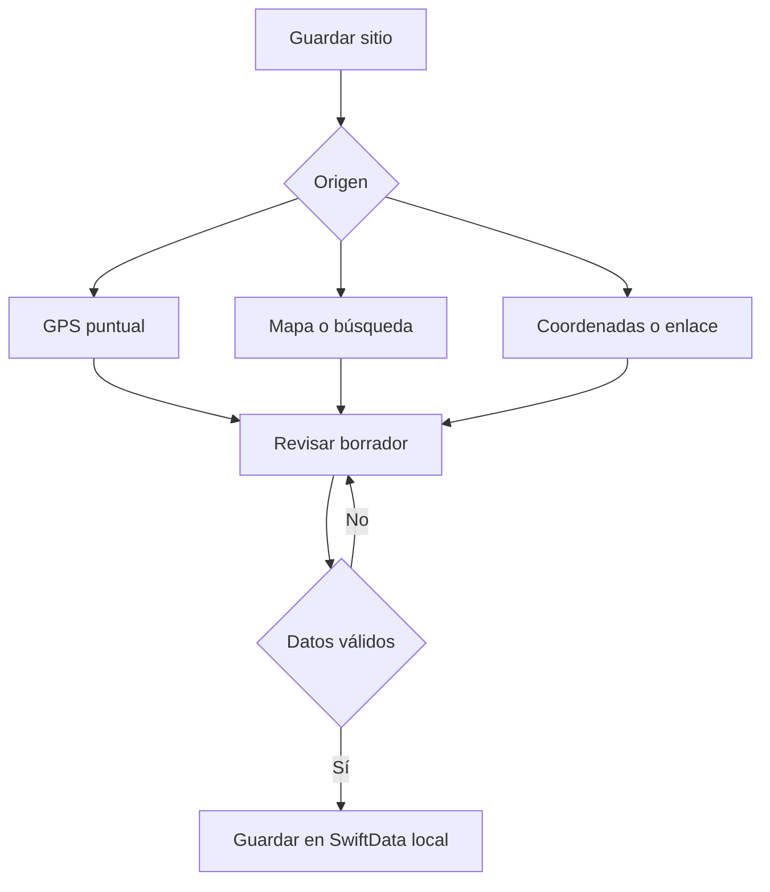

# Arquitectura y datos

## Elecciones

Swift + SwiftUI para una app nativa de iPhone. SwiftData para persistencia de modelos; MapKit para mapa y búsqueda; Core Location para GPS puntual. Sin dependencias externas. Se usa una estructura sencilla de vistas y servicios, sin añadir capas que un estudiante deba mantener sin necesidad.

## Componentes

| Archivo | Responsabilidad |
|---|---|
| `PinHavenApp.swift` | Abrir el contenedor local y presentar un error recuperable sin destruir la base |
| `Models/Place.swift` | Entidad persistente SwiftData |
| `Models/PlaceRecord.swift` | DTO portable, límites, búsqueda y formato versionado de respaldo |
| `Services/PlaceMapping.swift` | Convertir entre entidad persistida y DTO |
| `Services/LocalStore.swift` | Directorio local, exclusión de backup y transacción de importación |
| `Services/LocationService.swift` | Permiso y solicitud puntual GPS con timeout |
| `Services/MapLinks.swift` | Interpretar coordenadas explícitas y construir enlaces |
| `Views/HomeView.swift` | Consulta reactiva, filtros, lista y mapa |
| `Views/PlaceEditor.swift` | Borrador de creación/edición y validación antes de persistir |
| `Views/MapPicker.swift` | Seleccionar punto y buscar con MapKit |
| `Views/PlaceDetail.swift` | Consultar, compartir, navegar y borrar |
| `Views/BackupView.swift` | Importación/exportación con selección explícita de archivo |

## Flujo de captura

El editor conserva un `PlaceRecord` en memoria. Cancelar no muta la entidad existente. Solamente al guardar se aplica el borrador, se ejecuta `save()` y, ante fallo, `rollback()`.

## Modelo `Place`

| Campo | Tipo | Uso |
|---|---|---|
| id | UUID único | Identidad e importación repetible |
| name | String | Nombre personal obligatorio |
| address | String | Dirección opcional |
| latitude / longitude | Double | Punto exacto; valores decimales |
| notes | String | Contexto personal |
| category | String | Categoría principal |
| tags | String | Etiquetas, separadas por comas |
| isFavorite | Bool | Favorito |
| sourceURL | String | Referencia original; no se abre automáticamente |
| createdAt / updatedAt | Date | Auditoría local y orden |

## Persistencia

`Application Support/PinHaven/places.store`; carpeta marcada `isExcludedFromBackup` antes de abrir el almacén y con protección de archivos completa al crearse. CloudKit desactivado explícitamente. SQLite y archivos auxiliares son administrados por SwiftData; no editar manualmente ni empaquetar bases reales dentro del repositorio.

Si el almacén no abre, se muestra una pantalla de recuperación; no se sustituye silenciosamente por una base vacía ni por una base solo en memoria. Queda pendiente validar protección y exclusión en dispositivo real.

## Respaldo

Objeto JSON con `schemaVersion: 1`, `exportedAt` y `places`. UUID como cadena y fechas ISO 8601. El formato contiene todos los campos actuales de `PlaceRecord`; no hay imágenes en esta versión.

La importación limita archivo a 20 MiB y 10.000 registros, valida todos antes de insertar y rechaza UUID repetidos dentro del archivo. Agrega únicamente UUID no presentes y hace un guardado único. El error produce rollback. Los archivos exportados por esta versión tienen el formato que consume el importador.

Para cambiar el formato, incrementar `schemaVersion` y escribir migración explícita; no relajar silenciosamente validaciones. Para cambiar entidades persistentes en una versión distribuida, introducir `VersionedSchema` y `SchemaMigrationPlan` y probar contra una copia de datos anterior.

## Importación de enlaces

Solo HTTP/HTTPS de hosts concretos, más el formato directo `latitud,longitud`. Google: `query`, `q` o `destination` con par numérico. Apple: los anteriores y `ll` o `coordinate`. No interpretar `@lat,lon` de Google porque suele representar la cámara del mapa. No hay solicitudes de red para interpretar enlaces.

## Límites de escalabilidad

La versión inicial consulta todos los sitios y filtra en memoria; adecuada como punto de partida de una agenda personal, sin afirmación de rendimiento medida. Antes de grandes volúmenes, medir en iPhone y evaluar predicados SwiftData, índices, paginación y agrupación de marcadores. No almacenar fotos grandes como campos de texto o Base64 en este modelo.

## Sugerencias de dirección y navegación (2026-11-04)

AddressSearch mantiene sugerencias MapKit y resuelve únicamente la elección explícita. Un token invalida respuestas antiguas y la operación se cancela al salir o cambiar la consulta. CNPostalAddressFormatter conserva los componentes postales disponibles sin requerir acceso a la agenda. No cambia el esquema SwiftData. MapsWebView presenta la alternativa web con SFSafariViewController.

Compartir usa un URL universal por coordenadas. Google Maps instalado puede abrirse por comgooglemaps (declarado en LSApplicationQueriesSchemes); si no está disponible se usa el enlace universal. El punto guardado es el destino, independientemente del texto descriptivo.

## Referencia de búsqueda separada del sitio

PlaceEditor mantiene una instancia LocationService independiente para searchReference, sin mezclar sus callbacks con el GPS que fija el punto del sitio. Cambiar referencia o alcance vuelve a consultar AddressSearch; se conserva la misma región para resolver la sugerencia. regionPriority.required se protege por versión de compilador y disponibilidad iOS 18 para conservar compatibilidad Xcode 15/iOS 17. El menú de compartir reutiliza la apertura de Google existente.

## Compartir con extensiones de mensajería

LocationShareSheet encapsula UIActivityViewController con un solo String (nombre, dirección y enlace) capturado en LocationSharePayload. Sustituye ShareLink de URL para el botón Compartir con otras apps. El callback solo informa error local a la vista, que lo muestra tras cerrar la hoja; no representa confirmación de envío ni entrega remota.
